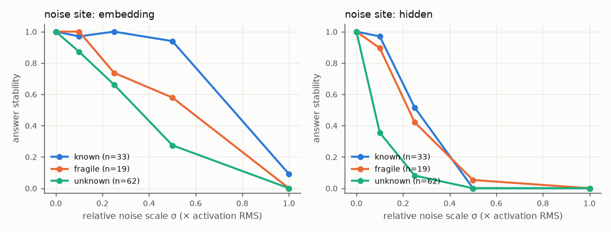
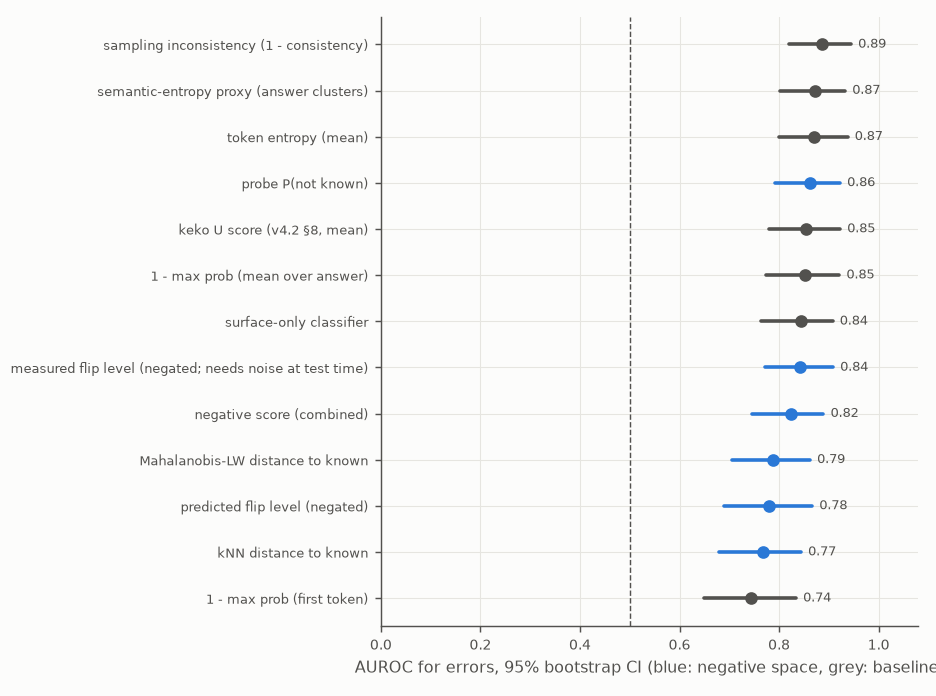
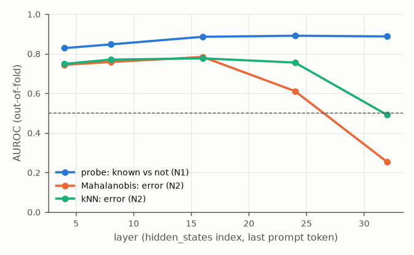
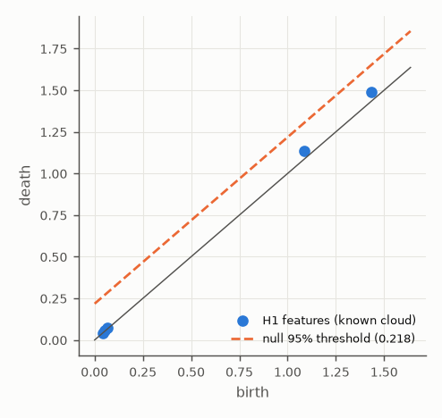
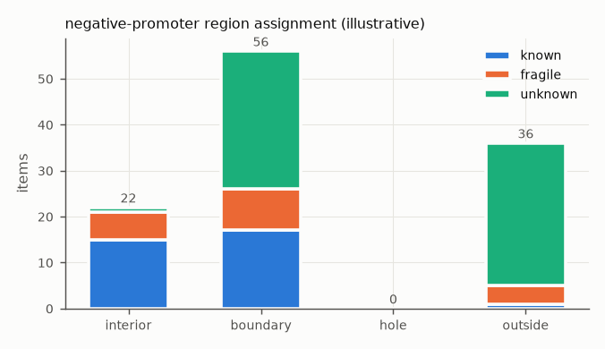

# Negative-space smoke run (SmolLM-360M, CPU)

> **Smoke run, not evidence.** SmolLM-360M-Instruct on CPU, 120 items, k = 3, one noise draw.
> This run only checks that every stage executes and produces well-formed outputs. Its numbers
> test none of N1–N6 (see [EXPERIMENT_PLAN.md](../../EXPERIMENT_PLAN.md) §0). With this few
> known items the CIs are wide and the topology section is statistically meaningless.
>
> **What the run surfaced (these are pipeline and design findings, not results):**
> * **Label noise from truncation.** With `max_new_tokens: 16` this chatty model often
>   truncates before it gives the answer ("signed on June 28, 191…"; "To solve this problem,
>   we can use the following steps…"). Most arithmetic "errors" are really truncations. In
>   the 30-item manual sample, 1 automatic label is clearly wrong (qa0170), and 9 arithmetic
>   items never reached an answer. Larger runs should use ≥ 32 new tokens or a stricter
>   "answer only" format.
> * **The control task is too easy with ~10 templates.** Control AUROC is 0.99, so
>   selectivity comes out negative: a probe can memorise the template identity perfectly.
>   The selectivity criterion needs many more templates (or controls keyed by entity rather
>   than by template) before it means anything.
> * **Length confound in the flip level.** ρ(flip, answer tokens) ≈ −0.37 at both sites,
>   which is exactly the confound N3's criterion (c) is designed to test.
> * **The model almost never abstains** (hallucination rate = error rate), so
>   fictional/unanswerable items are almost all errors, and surface features alone reach
>   AUROC 0.84.
> * Topology: 33 known points, no H1 feature above the null threshold (as expected at this n).

## Setup

- model: `HuggingFaceTB/SmolLM-360M-Instruct` (float32, device_map=cpu)
- items: 120 total, 114 analysed (ambiguous excluded: 6)
- kinds: {'answerable': 84, 'fictional': 19, 'unanswerable': 11, 'ambiguous': 6}
- labels: {'known': 33, 'fragile': 19, 'unknown': 62, 'ambiguous': 6}
- error rate (analysed): 0.53; hallucination rate: 0.53
- primary representation: `L16_last`; k samples = 3 (T=0.7); noise levels = [0.0, 0.1, 0.25, 0.5, 1.0], sites = ['embedding', 'hidden'], draws = 1
- grouped 5-fold CV × 3 seeds; bootstrap n = 1000

## N1: known-vs-not decodability

| score | AUROC [95% CI] | AUPRC [95% CI] | n |
|---|---|---|---|
| activation probe | 0.89 [0.83, 0.95] | 0.96 [0.93, 0.98] | 114 |
| probe (answerable only) | 0.79 [0.69, 0.88] | 0.90 [0.84, 0.95] | 84 |
| surface-only (length, domain, template) | 0.80 [0.72, 0.87] | 0.92 [0.88, 0.96] | 114 |

- probe - surface: ΔAUROC = 0.09 [0.03, 0.15], bootstrap p = 0.002
- control task (Hewitt & Liang style, random label per template): task AUROC 0.87, control AUROC 0.99, selectivity -0.13

### Layer-wise (out-of-fold, seed 0)

| representation | probe AUROC (not known) | Mahalanobis AUROC (error) | kNN AUROC (error) |
|---|---|---|---|
| `L4_last` | 0.83 | 0.74 | 0.75 |
| `L8_last` | 0.85 | 0.76 | 0.77 |
| `L16_last` | 0.89 | 0.78 | 0.78 |
| `L24_last` | 0.89 | 0.61 | 0.76 |
| `L32_last` | 0.89 | 0.25 | 0.49 |
| `L4_mean` | 0.85 | 0.40 | 0.73 |
| `L8_mean` | 0.85 | 0.38 | 0.73 |
| `L16_mean` | 0.87 | 0.58 | 0.79 |
| `L24_mean` | 0.87 | 0.58 | 0.77 |
| `L32_mean` | 0.86 | 0.54 | 0.73 |

## N2: error detection vs baselines

| score | type | AUROC [95% CI] | AUPRC [95% CI] |
|---|---|---|---|
| 1 - max prob (first token) | baseline | 0.74 [0.65, 0.83] | 0.80 [0.71, 0.89] |
| 1 - max prob (mean over answer) | baseline | 0.85 [0.77, 0.92] | 0.88 [0.81, 0.94] |
| token entropy (mean) | baseline | 0.87 [0.80, 0.94] | 0.89 [0.81, 0.95] |
| keko U score (v4.2 §8, mean) | baseline | 0.85 [0.78, 0.92] | 0.88 [0.81, 0.94] |
| sampling inconsistency (1 - consistency) | baseline | 0.89 [0.82, 0.94] | 0.87 [0.78, 0.94] |
| semantic-entropy proxy (answer clusters) | baseline | 0.87 [0.80, 0.93] | 0.85 [0.75, 0.93] |
| surface-only classifier | baseline | 0.84 [0.76, 0.91] | 0.86 [0.78, 0.93] |
| negative score (combined) | ours | 0.82 [0.75, 0.89] | 0.84 [0.75, 0.91] |
| probe P(not known) | ours | 0.86 [0.79, 0.92] | 0.88 [0.80, 0.94] |
| kNN distance to known | ours | 0.77 [0.68, 0.84] | 0.79 [0.69, 0.89] |
| Mahalanobis-LW distance to known | ours | 0.79 [0.71, 0.86] | 0.84 [0.76, 0.90] |
| predicted flip level (negated) | ours | 0.78 [0.69, 0.87] | 0.78 [0.66, 0.90] |
| measured flip level (negated; needs noise at test time) | ours | 0.84 [0.77, 0.91] | 0.83 [0.74, 0.91] |

Paired bootstrap ΔAUROC (ours - baseline):

| ours | baseline | ΔAUROC [95% CI] | p |
|---|---|---|---|
| negative score (combined) | token entropy (mean) | -0.05 [-0.11, 0.03] | 0.238 |
| negative score (combined) | 1 - max prob (first token) | 0.08 [0.00, 0.16] | 0.048 |
| negative score (combined) | sampling inconsistency (1 - consistency) | -0.06 [-0.14, 0.01] | 0.096 |
| kNN distance to known | token entropy (mean) | -0.10 [-0.20, -0.01] | 0.042 |
| kNN distance to known | 1 - max prob (first token) | 0.02 [-0.07, 0.11] | 0.582 |
| kNN distance to known | sampling inconsistency (1 - consistency) | -0.12 [-0.22, -0.02] | 0.014 |
| Mahalanobis-LW distance to known | token entropy (mean) | -0.08 [-0.17, 0.01] | 0.074 |
| Mahalanobis-LW distance to known | 1 - max prob (first token) | 0.04 [-0.04, 0.13] | 0.318 |
| Mahalanobis-LW distance to known | sampling inconsistency (1 - consistency) | -0.10 [-0.19, -0.01] | 0.026 |

Calibration (ECE, 10 bins): negative score 0.07 [0.07, 0.17]; 1 - max prob 0.09 [0.07, 0.19]

### Held-out domain (train on the other domains)

| held-out domain | n | error rate | negative score AUROC | entropy AUROC | 1 - max prob AUROC |
|---|---|---|---|---|---|
| arithmetic | 26 | 0.88 | 0.26 | 0.67 | 0.81 |
| dates | 20 | 0.60 | 0.56 | 0.67 | 0.50 |
| geography | 37 | 0.32 | 0.71 | 0.93 | 0.69 |
| science | 26 | 0.31 | 0.98 | 0.95 | 0.72 |
| unanswerable_keko | 5 | 1.00 | n/a | n/a | n/a |

## N3: progressive noise boundary

| site | median flip σ by label | AUROC flip→not known [CI] | AUROC flip→error [CI] | MWU p (known > not) | censored | ρ(flip, answer tokens) | ρ(flip, prompt tokens) |
|---|---|---|---|---|---|---|---|
| embedding | known: 1.000, fragile: 0.500, unknown: 0.500 | 0.81 [0.74, 0.88] | 0.77 [0.69, 0.84] | 0.000 | 0.02 | -0.37 | -0.31 |
| hidden | known: 0.500, fragile: 0.250, unknown: 0.100 | 0.80 [0.72, 0.86] | 0.84 [0.77, 0.90] | 0.000 | 0.00 | -0.38 | -0.17 |

Flip-level regression from activations (out-of-fold Spearman ρ): 0.51

## N4: topology of the known region (exploratory)

| PCA dim | points | H1 features | max H1 persistence | null threshold | significant holes | bootstrap frac > null |
|---|---|---|---|---|---|---|
| 3 | 33 | 2 | 0.007 | 0.232 | 0 | 0.00 |
| 5 | 33 | 5 | 0.054 | 0.218 | 0 | 0.05 |
| 8 | 33 | 3 | 0.005 | 0.188 | 0 | 0.00 |

Primary (PCA 5): not-known items inside significant holes: 0 (confident: 0); error rate in holes: n/a.

## N5 (illustrative only): negative-promoter regions vs the keko 0.3–0.7 window

| region | promoted behaviour | n | error rate | known / fragile / unknown |
|---|---|---|---|---|
| interior | `frozen_core_answers` | 22 | 0.05 | 15 / 6 / 1 |
| boundary | `clarify_and_adaptive_k_retrieval` | 56 | 0.50 | 17 / 9 / 30 |
| hole | `targeted_column_growth_and_ub_replay` | 0 | n/a | 0 / 0 / 0 |
| outside | `abstain_or_request_grounding` | 36 | 0.86 | 1 / 4 / 31 |

Behaviour promoted by the negative space (rows) vs what the keko window would trigger (columns):

| negative promoter \ keko window | `clarify_and_adaptive_k_retrieval` | `frozen_core_answers` |
|---|---|---|
| `abstain_or_request_grounding` | 6 | 30 |
| `clarify_and_adaptive_k_retrieval` | 30 | 26 |
| `frozen_core_answers` | 10 | 12 |

- keko window intervenes on 40.4% of items and covers 21 errors; the negative promoter intervenes on 80.7% and covers 59 errors (different intervention rates, so not directly comparable; see matched rates below).

| intervention rate | items | errors (total) | caught by top negative score | caught by lowest max prob |
|---|---|---|---|---|
| 0.10 | 11 | 60 | 11 | 11 |
| 0.20 | 23 | 60 | 20 | 20 |
| 0.30 | 34 | 60 | 30 | 28 |
| 0.40 | 46 | 60 | 36 | 36 |

## Figures

